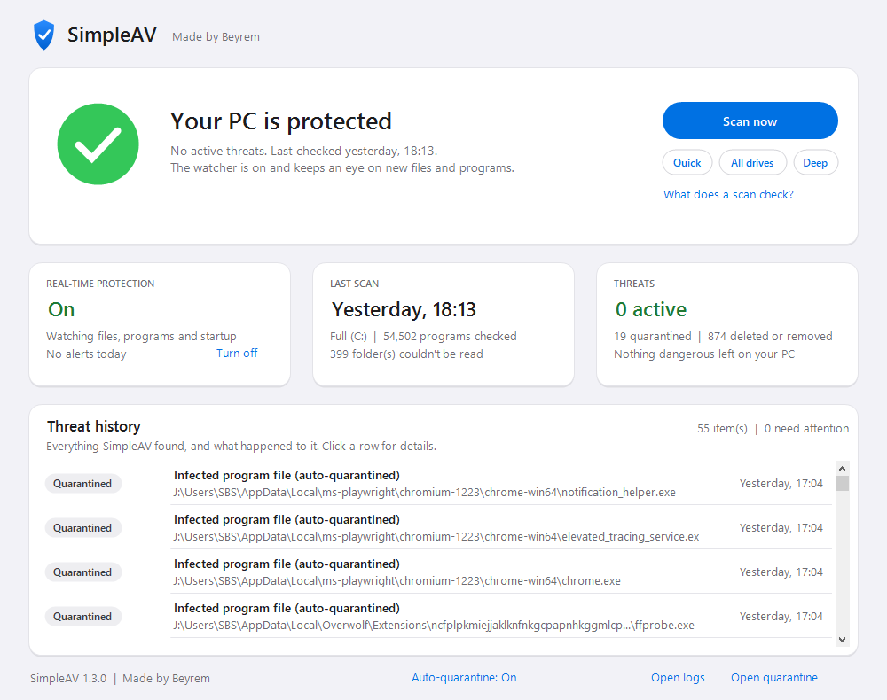
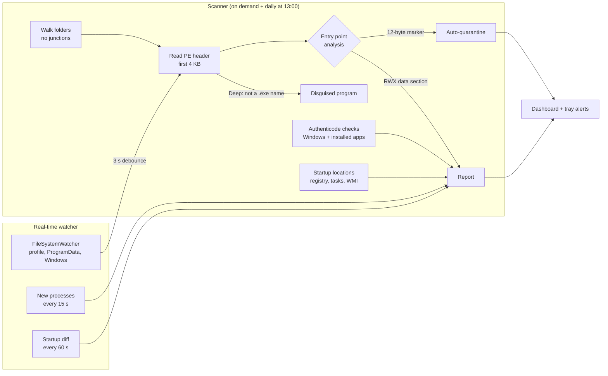

<p align="center"></p>

<h1 align="center">SimpleAV</h1>

<p align="center"><b>A targeted malware scanner and real-time watcher for Windows,<br>built after a file-infecting virus kept coming back on my own PC.</b></p>

<p align="center">
  
  
  
  
  
</p>



<p align="center"><i>Made by Beyrem</i></p>

**In 60 seconds:** my PC got a virus that patched **865 programs** and survived every antivirus "removal". I traced
it to four cooperating parts, the worst being a fake `omadmapi.dll` that Windows Explorer loaded at every start.
Then I wrote SimpleAV to find exactly those tricks. On its first real scan it found **2 infected programs** and the
**fake DLL** that the earlier cleanup had missed. When the infection came back later, SimpleAV caught it: it
quarantined **18 freshly infected programs** on its own, and the dashboard showed every hook the malware had
re-created.

> [!IMPORTANT]
> **SimpleAV is not a general-purpose antivirus.** Its signature matches **one** file-infector family (the one on
> my PC). Its other checks are generic rules built from that malware's techniques. **Keep Windows Defender on.**
> See [Limitations](#limitations).

---

## The story

In **June 2026** a stranger who had hijacked a friend's Discord account sent me a file from it, and I ran it.
I found **Blank Grabber**, an account stealer, wiped my system and cleaned up. What I didn't find was the second
thing that came in with it: a file infector.

It survived the cleanup. Malwarebytes kept finding the same threats (`Spyware.DarkSide`, `Trojan.Crypt`,
`RiskWare.MSBuild.Abused`), reported "removed", and after every reboot they were back.

This time, instead of wiping again, I took the infection apart: the registry, scheduled tasks, the Windows Installer
database, and byte-level comparisons of infected vs. clean copies of the same programs. It turned out to be
four parts working together:

| Part | What it did | Why the antivirus kept losing |
|---|---|---|
| **File infector** | Patched **865 programs** (Discord, VS Code, Steam, npm tools...) so its code ran first every time one started | Each infected program could re-infect others |
| **Loader** (PavinLoader) | Installed as fake **Broadcom / Logitech** driver software; ran hidden C# through a copied `MSBuild.exe` | Runs through a Microsoft-signed tool ("living off the land") |
| **Registry payload** | Stored Base64-encoded in `HKCU\Environment\UserCache`, launched at every logon by **two hidden hooks** (Winlogon `Shell` + `UserInitMprLogonScript`) | **The AV deleted the payload but never the hooks**, so it was rebuilt at the next login |
| **DLL hijack** | An unsigned 56 KB `omadmapi.dll` dropped in `C:\Windows`, next to `explorer.exe`. The real one is a 225 KB signed file in `System32` | Windows loads a DLL from the program's own folder first, so **Explorer loaded the fake one at every start** |

It also blocked Defender's scanner (`MpCmdRun.exe`) with an IFEO "debugger" hijack, and hid a crypto-miner as `.jpeg` files.

### How I found the infector's fingerprint

Comparing a clean and an infected copy of the same program showed the same pattern in every infected file:

| | Clean program | Infected program |
|---|---|---|
| Section where execution starts | `.text` (code) | the **last** section, e.g. `.reloc` (normally data) |
| That section's permissions | read-only data (`0x42000040`) | **read + write + execute** (`0xE0000040`) |
| Digital signature | valid | **stripped** |
| First 12 bytes executed | normal code | **`E8 D9 00 00 00 48 8D 58 FB 51 52 41`** |

That gave me two detections: an **exact** one (those 12 bytes at the entry point) and a **structural** one (entry
point moved into a writable + executable data section at the end of the file).

### Did it work?

- SimpleAV's first full scan found **2 more infected programs** the manual cleanup had missed, in Docker Desktop
  and OpenCode. The infector had put its code in sections with unusual names (`.symtab`, `.bun`), so the
  structural rule didn't fire, but the **exact-byte check caught both**.
- It **independently flagged the fake `omadmapi.dll`**, which was then quarantined.
- After a reboot, re-scans were **clean** and reinstalled apps were verified clean (valid signatures, no virus code).

### Then it came back, and SimpleAV caught it

On **16-17 November 2026** the infection returned. This time SimpleAV was already running:

- The **exact-byte check auto-quarantined 18 newly infected programs** without me doing anything: Discord, Claude
  Code, an installer sitting in `Downloads`, files dropped in `%TEMP%`, and programs on a second drive that holds an
  old Windows profile.
- The **dashboard flagged all four registry hooks** (`UserCache`, `UserInitMprLogonScript`, the Winlogon `Shell`
  launcher, the fake CLSID) and the **fake `omadmapi.dll`**, all back in place.
- I backed up and removed the hooks, then quarantined the DLL through SimpleAV with one admin prompt.

What re-installs the infection hasn't been found yet. The old profile on the second drive is the main suspect.
Coming back twice after a cleanup is the strongest sign that this PC needs a clean Windows reinstall, and that's the
plan. This is also exactly why SimpleAV keeps watching instead of scanning once: a one-time cleanup tool would never
have noticed.

Full write-up with MITRE ATT&CK mapping: **[docs/HOW-IT-WORKS.md](docs/HOW-IT-WORKS.md)**.

---

## How it works



### 1. Byte-level program inspection
`Get-PEVerdict` ([src/SimpleAV.Detection.ps1](src/SimpleAV.Detection.ps1)) opens each file read-only (with sharing
flags, so locked files still open), reads the first 4 KB, and parses the PE format by hand: `MZ` → `e_lfanew` →
`PE\0\0` → section table. Headers that run past 4 KB are re-read up to 64 KB, so padding the header can't hide a file.
It finds the section that contains the entry point, converts the entry-point RVA to a file offset, and reads the 12
bytes that actually run first. It works on both 32-bit and 64-bit programs, and it reads the **content**, never the
file name or date. The malware faked both.

The scanner and the dashboard share this one file. That way "is this file infected?" and "is this file *still*
infected?" can never give different answers.

### 2. Disguised programs (Deep scan)
Deep scan opens **every** file on every drive and checks the header. A real Windows program saved as `.jpeg`,
`.pdf`, `.txt`, etc. is flagged HIGH. That's how the miner was hidden.

### 3. Signature and integrity checks
- **Tampered files:** every program in `System32`, `SysWOW64`, `drivers`, `Program Files` and user-installed apps is
  checked with Authenticode. `HashMismatch` means the file changed after it was signed.
- **DLL hijacks:** an unsigned DLL in `C:\Windows` with the same name as a `System32` file is flagged. This is the
  exact rule that caught `omadmapi.dll`.
- **Baseline of unsigned system files:** some old Microsoft runtimes are legitimately unsigned. They're remembered by
  path + SHA-256 on the first scan, and only **new or changed** ones are reported later.
- **Signature cache:** Authenticode is the slowest check, so each result is cached by path + size + last-write time.
  A file that hasn't changed isn't re-verified, and any modification changes the key and forces a fresh check.
  Measured on my PC: a Quick scan went from **169 s to 41 s** on the second run (8,399 of 8,399 checks reused).
- **Self-integrity:** at install, SimpleAV records the SHA-256 of each of its three scripts and warns if any of them
  changes.
- **Defender blocking:** IFEO "debugger" entries on security tools (`MpCmdRun.exe`, `MsMpEng.exe`, Malwarebytes,
  Task Manager...) are flagged HIGH.

### 4. Persistence checks
Run/RunOnce keys, Winlogon `Shell`/`Userinit`, logon scripts, `HKCU\Environment` hooks, the loader's fake CLSID,
IFEO, AppInit DLLs, startup folders, scheduled tasks and WMI event consumers. Command lines are matched against
patterns this malware used: `FromBase64String`, hidden encoded PowerShell, `conhost --headless`, MSBuild, script
hosts, and programs run from `%TEMP%`.

### 5. Real-time watcher
- **Files:** `FileSystemWatcher` on the user profile, ProgramData and `C:\Windows`. Program files are checked once
  they stop changing for 3 seconds, so half-written downloads aren't misread. Each pass drains the whole event queue
  first, so a burst of thousands of events (an `npm install`, a game update) can't delay the process and startup
  checks. If the event buffer overflows, the watcher logs that changes were missed instead of dropping them silently.
- **Processes:** new processes every 15 s. It looks for hidden encoded PowerShell, MSBuild run from odd folders,
  and infected programs that are running. Processes are tracked by ID **plus start time**, because Windows reuses
  process IDs.
- **Startup:** every location above is snapshotted and diffed every 60 s. A new or changed entry raises an alert.
- **No self-whitelisting by name:** SimpleAV skips only its *own* scripts, matched by full installed path. Malware
  can't hide by putting `SimpleAV.ps1` in its command line. A test checks exactly that.

### 6. Quarantine
Quarantine means **move, never delete**. The file is renamed `*.quarantined` so it can't be opened by
double-clicking, and a record next to it keeps the original path, SHA-256, time and reason. Only **exact** virus
matches are quarantined automatically (you can switch this off). Everything heuristic waits for a click, so a false
alarm can never break a real program.

**Restore is treated as untrusted input**, because the record sits in a user-writable folder:
- It refuses if the record's path isn't a normal absolute path. This blocks a tampered record from steering the
  file into the Startup folder.
- It refuses if the file's SHA-256 no longer matches the hash taken at quarantine time.
- It **never overwrites** a file already at the original location, such as a clean reinstall.

Administrator rights are requested only when Windows actually denies access. A locked file or a bad record never
triggers an admin prompt.

### Design decisions
- **Detect by content, not names or dates.** The malware faked timestamps (2021) and file types.
- **Automate only what is certain.** Exact byte match → quarantine. Anything heuristic → report.
- **Be honest about coverage.** Every scan logs how many files it opened and how many folders Windows wouldn't let it
  read, so nothing is skipped silently.
- **No dependencies.** It's plain PowerShell 5.1 + .NET, both signed by Microsoft and on every Windows 10/11 PC. A
  tool that cleans an infected machine shouldn't depend on programs the infection may have modified.
- **Why `-ExecutionPolicy Bypass`.** The scripts aren't code-signed, and Windows' execution policy is a guard against
  running scripts by accident, not a security boundary (Microsoft says so itself). SimpleAV protects its own files
  differently: it records their SHA-256 at install and warns if any of them changes.

---

## Install

1. Download this repository (**Code → Download ZIP**, then extract it), or clone it:
   ```
   git clone https://github.com/aboutbeyrem/SimpleAV.git
   ```
2. Double-click **`Install.cmd`**.

SimpleAV copies itself to `%USERPROFILE%\SimpleAV`, starts the real-time watcher (it then starts at every login),
schedules a daily scan of all drives at 13:00, and adds a **SimpleAV** shortcut to the desktop and Start menu.
No administrator rights are needed.

To remove it, double-click **`Uninstall.cmd`**. Your logs and quarantine are kept.

## Use

Open **SimpleAV** from the desktop or Start menu:

| Button | What it scans | Time |
|---|---|---|
| **Scan now** | every program on `C:` + system signatures + startup entries | ~7 min |
| **Quick** | programs in your user folder | a few min |
| **All drives** | every program on every drive | longer |
| **Deep** | **every file** on every drive, checking what it really is | hours |

Click any row in **Threat history** to see what it is and to quarantine or restore it.

Command line (from `src`):

```powershell
powershell -ExecutionPolicy Bypass -File SimpleAV.ps1 -Scan            # full scan of C:
powershell -ExecutionPolicy Bypass -File SimpleAV.ps1 -Deep            # every file, every drive
powershell -ExecutionPolicy Bypass -File SimpleAV.ps1 -Paths D:\Games  # one folder
powershell -ExecutionPolicy Bypass -File SimpleAV.ps1 -Quarantine "C:\path\file.exe"
powershell -ExecutionPolicy Bypass -File SimpleAV.ps1 -Restore    "%USERPROFILE%\SimpleAV\quarantine\file.exe_....quarantined"
Get-Help .\SimpleAV.ps1 -Detailed
```

Logs (one `.log` + `.csv` per scan) are in `%USERPROFILE%\SimpleAV\logs`.

## If SimpleAV finds something

- **Infected program file:** quarantine it (click the row), then reinstall the app from its official website. Don't
  reinstall from an old installer in `Downloads`: installers get infected too.
- **Startup entry** (`HKCU\Environment` value, Winlogon `Shell`, Run key, the fake CLSID): back it up first
  (`reg export "<key>" backup.reg`), then delete the value with `regedit` or `Remove-ItemProperty`. Remove the
  **launchers before the payload**, or the payload gets rebuilt at the next logon.
- **IFEO "debugger" on a security tool:** delete the `Debugger` value under
  `HKLM\SOFTWARE\Microsoft\Windows NT\CurrentVersion\Image File Execution Options\<program>` (needs admin).
- **Fake DLL next to Explorer:** quarantine it from the dashboard (one admin prompt), then restart your PC.
- **Suspicious scheduled task:** `Unregister-ScheduledTask -TaskName "<name>"`.
- **It keeps coming back:** something you haven't found is reinstalling it. Back up your documents (not programs or
  installers), change your passwords from another device, and reinstall Windows.

## Tests

```powershell
powershell -ExecutionPolicy Bypass -File tests\Run-Tests.ps1
```

The suite builds **harmless** samples: tiny hand-made PE headers (64-bit, 32-bit, and one with its header pushed past
4 KB) that contain the virus's marker bytes but no runnable code, plus a renamed copy of Notepad.

It covers:
- every detection
- auto-quarantine on and off
- quarantine and restore, including every restore refusal: existing file, changed hash, tampered path
- the signature cache
- the startup-entry rules, including the "malware names itself SimpleAV.ps1" bypass
- the self-exclusion
- the dashboard, including logs written on a French-language Windows (`54 509` with a no-break space)

Samples live in `C:\SimpleAV-test-*`, outside every folder the real-time watcher watches, so an installed copy of
SimpleAV can't grab them mid-test. **47/47 tests pass.**

## Limitations

SimpleAV is a focused tool, not a replacement for a full antivirus.

- **The exact-byte signature only identifies one virus family.** Other viruses won't match it.
- The structural rule is tuned to how *this* family patches programs. It may catch close variants, but it isn't a
  general infection detector.
- The startup, DLL-hijack, disguised-program and signature checks are generic rules. They can flag other malware's
  tricks, but they're no substitute for a signature database covering thousands of families.
- Without administrator rights it can't read some protected Windows folders. The count is shown after every scan.
- It doesn't look inside `.zip` / `.rar` archives or installers.
- It contains an infection; it doesn't find *what keeps reinstalling it*. On my PC that is still unknown, which is why
  the real fix is a clean Windows reinstall.
- Quarantined files are renamed, not encrypted. They can't be opened by double-clicking, but a program that is
  pointed at the full path could still load one.
- The first scan remembers every unsigned system file already present as "known". On a PC that is already infected,
  read that first scan's log: anything malicious in that list won't be reported again.
- The self-integrity hashes live in the same user folder as the scripts. They catch accidental or careless tampering,
  but malware running as you could rewrite both.

## Project structure

```
Install.cmd / Uninstall.cmd   one-click install / removal
src/SimpleAV.Detection.ps1    byte-level PE inspection, shared by the engine and the dashboard
src/SimpleAV.ps1              engine: scanner, real-time watcher, quarantine, installer
src/SimpleAV-App.ps1          dashboard window (WinForms, custom-drawn)
src/SimpleAV.ico              app icon (generated by tools/Build-Icon.ps1)
tests/Run-Tests.ps1           automated tests
tests/New-TestSamples.ps1     harmless test-sample generator
tools/Build-Icon.ps1          draws the logo and builds the multi-size .ico
docs/HOW-IT-WORKS.md          analysis of the infection and the detection logic
```

## Acknowledgements

The investigation, the design, the decisions and the real-world cleanup are mine, on my own infected PC. I built it
with AI coding agents (Claude Code by Anthropic) as my tools for writing code and digging through evidence, and every
commit says so. The dashboard follows Apple's Human Interface Guidelines: one primary action, clear status, plain
language.

## License

[MIT](LICENSE) © 2026 Beyrem
